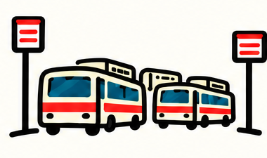

# 已选地标 badge 范例 r1

十八个图像文件组成九组 S/L 画风参考；S 是功能符号，L 是中号 badge。文件保留浅纸色背景，全部尚未准备为生产精灵，也未注册或接入运行时。四张存在已确认的裁切缺陷，见下表。保留这些文件用于查阅选定画风，不代表轮廓完整或历史复原。定义见 [美术契约](../../../docs/HANDPAINTED_MAP_ART.md#landmark-badges)。

| 地标 | S | L |
| --- | --- | --- |
| 丰台影剧院 |  |  |
| 丰台火车站 |  |  |
| 丰台花园 |  |  |
| 世界公园 |  |  |
| 马厂公交总站 |  |  |
| 机务段 |  |  |
| 丰台一中 |  |  |
| 丰台医院（旧址） |  |  |
| 铁路医院 |  |  |

## 已确认的裁切缺陷

| 文件 | 问题 |
| --- | --- |
| `school-one-s.png` | 书本右侧轮廓被截断。 |
| `school-one-l.png` | 左侧残留相邻书本的轮廓碎片。 |
| `world-park-l.png` | 左侧残留相邻符号的轮廓碎片。 |
| `railway-hospital-s.png` | 右下角带入相邻建筑的基线。 |

[manifest](manifest.json) 以 `productionReady: false` 标记整套参考，并在 `knownCropIssues` 中列出这四张图。PNG、原裁切记录、尺寸及哈希保持原样；本次只纠正准备状态和验收说明。去除纸色背景不能补回缺失轮廓，也不能代替邻图清理。正式接入前须修复上述裁切问题，完成透明边缘或获准底色处理、统一锚点、最终尺寸和地图避让验证，再登记生产资产版本。
