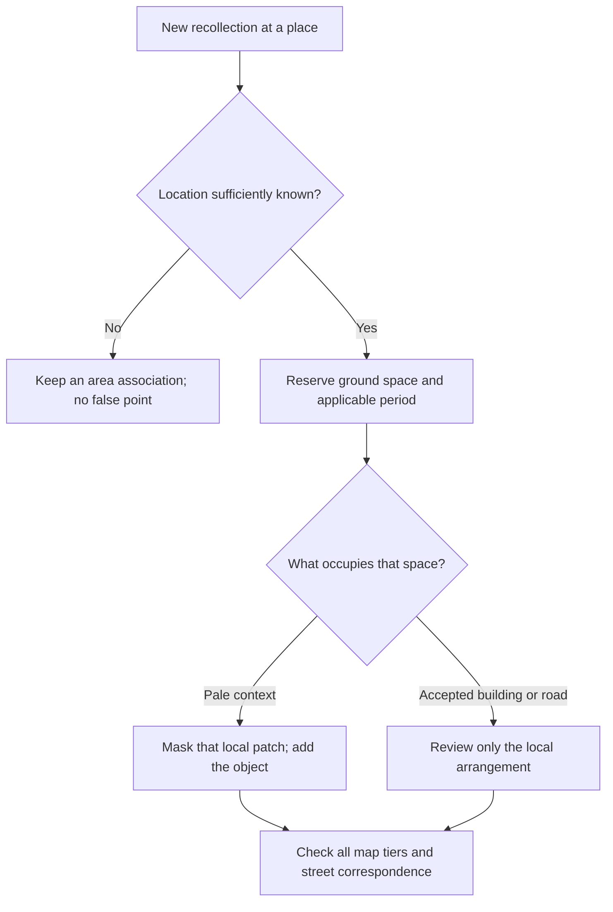

# A layered map that can be completed one memory at a time

> DM-0015: [hand-painted map art](HANDPAINTED_MAP_ART.md) is the current medium/projection/height-identity contract. SVG defines planning geometry, never visible map artwork. The r4 vector fallback and procedural yard decorations below describe a superseded implementation, not accepted art. Isometric studies must share their ground/roof/vertical axes; do not paste a new-camera building onto the old north-up ground or distort it to fit.

> DM-0013: [validated asset workflow](ASSET_WORKFLOW_VALIDATION.md) supersedes whole-compound affine fitting and whole-image road masking as the production method. DM-0014 implements independently anchored building parts, separate worn-yard ground and standing depth order. Ground bounds, visual bounds and standing-art occlusion must be distinct.

The composition planner is connected to the visible overview. The selected R7 recovery uses the same source-linked raster consumer, restoring local Sili/Liuli grouping, sparse travel-map strokes and Qili frontage registered to the selected street. The selected outline street has its own [drawing workflow](research/XINHUA_OUTLINE_WORKFLOW.md) and runtime lifecycle. Geometry, visual acceptance and historical verification remain separate. [STATUS](STATUS.md) and [RUNTIME](RUNTIME.md) own current implementation; dated records below preserve earlier planner and art evidence.

Numbered Xinhua estates use concise orientation labels such as 三里/四里/六里/七里; their full names and identities remain in registration. Label candidate envelopes follow the principal residential masses rather than unrelated low frontage. Their explicit `labelWithinGroup` presentation setting keeps names inside the corresponding registered display group: first seek clear ground, then allow text with the normal paper halo over that same group's artwork or low-information flat/unnamed low-rise frontage context if needed. Other principal groups, named frontages, other labels and the menu control still block placement. Names must not be pushed across a road to obtain a collision-free result. For flat context, collision avoidance uses the actual raster alpha bounds across all three levels, leaving transparent image padding available for text; render bounds and physical geometry remain unchanged. Period-hidden landmarks do not reserve label space. The ordinary app-panel viewport and desktop block view both retain the three repaired estate names within their corresponding groups.

Registered R7 objects also carry conservative rectangles covering the union of actual raster alpha across all levels. These avoid treating the empty courtyard inside an L/U-shaped painting as a solid rectangular obstruction. They are derived label metadata; they do not change image cropping, source rings, physical geometry or collision/navigation.

Sili's narrow north/south group uses a vertical 四里 label at the same readable type size, keeping the name inside its group in an ordinary narrow app panel.

## Current experience contract — 2026-10-19

The normal interaction hierarchy is overview area → registered route/street → roadside attachment. Overview gates, hospital signs and compound silhouettes are orientation representations; visible does not mean directly enterable. Route attachments resolve note, static sequence or local scene only after street entry. [INTERACTION](INTERACTION.md) and [DATA_MODEL](DATA_MODEL.md) own the details.

The acquired source plan remains available, but not every source footprint must be painted. Select depiction by observed street interface, familiarity and memory purpose independently of geometric confidence. Large unfamiliar compounds may be represented by a recognizable gate and sparse compatible masses, or omitted at town scale. Unknown interior extent is not a reason to invent a precise closed boundary.

An icon may conceal low-information background through ordinary compositional overlap. Its scale changes painted bounds, not source footprint, walking collision or a doorway's approach position. It must not hide a meaningful road, neighboring remembered entrance or a known topology error. Preserve coherent projection, height family where an actual mass is represented, route continuity and stable anchors.

Preserve the source geometry and building orientations in the selected spatial plan. R7's corrected Sili/Liuli membership changes grouping rather than moving those physical outlines. Representation selection can remain sparse where internal layout is not the memory object.

## The picture we are assembling

The entire viewport is a lightly drawn city. Overview roads use soft gray pen edges and a paper-compatible wash; they do not imitate black asphalt or advertise clickability through dark fill. The entered street may use asphalt and sidewalk materials. A few recognizable landmarks and registered memories have full color and solid silhouettes. Between them, pale roof patterns and vegetation suggest what occupies the land without pretending that every shop or building is known. Adding a recollection changes only the relevant local content/representation; it does not automatically increase geometric detail or historical certainty.

The distinction is **visual emphasis**, not a truth score. A vividly remembered reconstruction may still be historically uncertain; a well-documented neighboring building may remain pale because it is context. Store evidence, date support, author approval, visual emphasis and publication permission separately.

## Composition layers

| Layer | Contents | Boundaries and replacement unit |
| --- | --- | --- |
| Paper / ground wash | Continuous restrained texture and broad land color | Covers the viewport, including beyond the registration region. Contains no named or identifiable buildings. |
| Context patches | Pale roof grain, tree canopy, repeated slab orientation, low housing or open ground | Usually one street-bounded district with several smaller replaceable patches. No road, text, entrances, memories or clickable fake buildings baked in. |
| Road assemblies | Asphalt, service roads, sidewalks, dividers, crossings; bridge decks, abutments, retaining walls, ramps | Split at real junctions, bridge transitions or profile changes, not arbitrary image edges. Do not include surrounding residential buildings. |
| Compound structure | Building shells, yard areas, fences, gates and detached commercial rooms | A compound is a container of objects, not a single irreversible painted rectangle. Overview grouping is permitted; occupancy and entrance relations remain separate. |
| Landmarks / remembered objects | Theater, hospital exterior, a recognizable gate, a registered shop or small building | Stable object identity and actual ground reservation; separate assets per view/detail tier. Full-color emphasis never moves the road. |
| Words / memory access | A small selection of place names, selected recollection and intentional interaction | Labels and hit regions are not baked into artwork. No permanent marker field, toolbar or development information. |
| Street scene | Registered local geometry, selected building/frontage representation and grounded person; currently the Xinhua/Sanli outline scene | A separate view of the same registered places and route positions. No figure or player marker anywhere on the overview. |

These are **ownership layers**, not one universal back-to-front paint order. A bridge must cover the road below it; its far wall and near wall may render on different sides of the scene. Building shadows, roofs and ground footprints also require different masks. Explicit occlusion relationships override the ordinary ground-depth sort.

## Three overview tiers, then enter a street

The tiers use the same stable locations and drawing layout. They change what is represented, not where a place is. Smooth motion between tiers is optional; three clear stops are enough. Wheel/pinch and menu zoom use the same tier selection, with hysteresis near thresholds to avoid flicker. Tier switching must preserve the point under the pointer or the current map center.

| View | What becomes legible | Context and roads | Initial label budget per viewport |
| --- | --- | --- | --- |
| Town | Two bridge anchors, principal roads and only useful theater/park/compound silhouettes; a hospital need not appear at this scale | Very pale land and roof grain; unmistakable bridge crossing order. Sidewalk/service corridor remains recognizable as part of the road assembly. No individual windows. | About 8–12; prototype 10 |
| Neighborhood | Sanli/Wuli/Sili/Liuli/Qili and Nankai Xili typology and arrangement; separate towers, long slabs and court boundaries; local commercial anchors | Stronger but still pale contextual silhouettes. Main road, service road and sidewalk are separable; important setbacks and retaining-wall lengths become visible. | About 12–18; prototype 16 |
| Street surroundings | Gates, detached street shops, walls, crossings, entrances and nearby memories | Same oblique planar map, still without a figure. Context remains faint rather than inventing more precision. Prioritize walking space. | About 6–10; prototype 10 |
| Entered street | A bounded walkable stretch, recognizable facades/gates and supported local destinations; future attachments follow the shared contract | Current Xinhua/Sanli: elevated perspective view, continuous outline person, sparse contours and normal depth occlusion. Legacy scenic flats/GLB framing are historical references. | Only locally useful names |

The numerical budgets and initial context opacities (0.16 / 0.22 / 0.26) are **tuning proposals**, not aesthetic acceptance. Draw pale pigment deliberately; avoid transparent ghost towers, dark ambient glows or a gray veil over the whole town. Unknown context must remain subordinate even at the closest map tier.

A small remembered shop may be omitted at town scale. If its solid representation is omitted, its patch must remain pale and filled: never cut a hole for an invisible object. A landmark silhouette at the town tier can stand for the same place that has several facade modules at street scale. Missing near assets do not justify stretching a coarse image indefinitely. The renderer supplies its successfully loaded asset references to the planner; an unavailable solid asset must leave the pale filling intact. Omitting that list is for symbolic/offline planning only.

### Named content allocation

| Content | First useful overview tier | Placement rule |
| --- | --- | --- |
| North road bridge / south railway bridge; 看丹桥 | Town | Distinct identities and levels. Never merge the two Fengtai bridges into one symbol or put the railway underground. |
| 新华街, 四环, 丰台南路, 正阳大街 | Town | Continuous independent road assemblies; protect service roads and sidewalks, not just the centerline. |
| 丰台影剧院; separately identified hospital sites | Only the tier where orientation benefits; hospital depiction may wait until street surroundings | Keep site identity independent of an institutional merger. A gate/sign can suffice. No automatic phase-scope expansion or direct overview-to-interior link. |
| 新华街各里, 南开西里 | Neighborhood | Actual tower/slab/low-rise families and orientations; no generic European houses or decorative old-Beijing courtyards. |
| Bridge-north KFC; bridge-north McDonald's; bridge-south McDonald's | Neighborhood | Three distinct place records. Precise site/period still requires evidence; unresolved records stay out of the rendered map. |
| 丰台花园, the intended 党校, public exterior of large compounds | Neighborhood; major park silhouette can appear farther out | Verify which place is meant before placing it. Sparse surroundings extend beyond the registration scope. |
| Gates, detached commercial rooms, small shops and remembered corners | Street surroundings | Place as short independently replaceable units; do not imply every residential ground floor is retail. |
| Former “富士商场”, unidentified school-front street and old school entrances | No automatic placement | Keep as research candidates until identity/location is resolved; never substitute a current institution or an approximate named shop. |

This is a content allocation rule, not a claim that every listed object has been drawn or registered. The residential survey remains in [PR5](https://github.com/StarObserverPro/DigitalMemory/pull/5).

## Filling places without a specific memory

Use three levels of contextual specificity, constrained by evidence and independently selected for memory relevance/visible extent. Better evidence permits detail; it does not require displaying it:

1. **Land use / vegetation only:** a soft warm-gray or green wash where even building type is uncertain. Do not invent roof ridges, hutongs or shop signs.
2. **Known building family and orientation:** pale repeated long slabs, compact tower silhouettes or irregular low-roof grain. Preserve approximate density, orientation, open space and green coverage from satellite/reference evidence; window counts and minor unit differences are irrelevant.
3. **Known arrangement:** a subdued compound drawing with independently addressable building groups and yard patches. Important gaps, gates and frontage setbacks remain editable.

Satellite imagery is a reference layer in the authoring workspace. Extract roof orientation, massing, approximate height family and vegetation into original compatible art; do not mix a raw photo tile with illustrated streets as the default finished map. A current satellite image alone does not prove a 2005 layout. Keep source acquisition dates and supported periods in the recipe.

Each patch can have period-specific recipes (for example low housing versus later tower/slab massing). Its fallback recipe must be a neutral land/vegetation wash, not a silently borrowed modern roof pattern. Context is **non-interactive and unnamed**. Its components never become places, doors or historical evidence just because a generator drew them. The paper wash covers missing/out-of-view patches; neighboring patches use consistent palettes, world-anchored texture and padded seams. Loading a new patch must not scatter or randomize accepted neighbors.

## Gate-centered representation and continuous transitions

A gate/short boundary is the primary visible unit when internal layout is neither known nor useful. Keep the familiar street face legible, suggest only the supported rear typology, and reduce contour density, contrast, object count and explicit closure into continuous ground/paper treatment. Do not merely lower opacity on a fully detailed invented campus or cover it with game-like exploration fog.

The street-view refinement may deliberately leave an unfamiliar rear building's upper contour open or unpainted while keeping the foreground/backdrop relationship legible at the walking camera. For ordinary street masses, approximately five to six storeys is the useful drawing band: lower buildings retain their full silhouette; taller background buildings retain that lower band before opening above it. This is approximate visual guidance, not a per-building floor-count gate; selected recognition landmarks keep their required height relationships. Source footprint, direction and height stay intact; no new horizontal cap should turn a tall source building into a short closed one. Map flattening is a separate representation choice: a selected building becomes a ground-plane block with no facade or visible height. The [outline workflow](research/XINHUA_OUTLINE_WORKFLOW.md#按行走视线选择前后轮廓--2026-10-28) owns the close-view treatment and its acceptance scope.

Boundary-wall, railing and frontage recipes use [LAYER_COMPOSITION](LAYER_COMPOSITION.md). Revealing a background through rails does not require accurate internal corridors; opaque brick wall and detached frontage have their own occlusion. A generic hospital identifier or period-appropriate school gate is a recognition aid, not proof of an exact historical sign or borrowed fictional architecture.

Zoom reveals only useful available information. It does not force an unfamiliar rear compound to become detailed at the nearest tier. Context can remain conceptually sparse at every tier. The nearby gate may become clearer while the interior remains an intentional omission.

At the finest overview tier, selecting the street still enters the route scene. A larger gate symbol does not capture the map click and bypass that route. Hit masks must respect this separation.

## How a newly remembered building fits

A concrete example: a vaguely drawn corner behind a sidewalk gains a remembered one-storey shop. Its registered place gets an independent shell or frontage slot, a ground reservation, period membership and overview/street representations. The context under its occupied ground is masked; the nearby slab building, route, sidewalk and bridge stay unchanged. At a tier where the shop is too small to render, the pale patch remains. In a period before that shop is supported, the appropriate earlier environment or pale context returns.

If the recollection is of an already drawn building, attach a memory to that identity and change its emphasis or selected representation; do not create a duplicate building. If it is a tenant change, update the occupancy in a frontage slot; do not rebuild the shell. A separate shop outside a residential block owns a separate shell related to its compound, not an automatic first-floor overlay.

If a new object overlaps an accepted neighbor, reject silent placement. Locally split a context group, replace that small group's composition or adjust its **drawing** scale/setback within a reviewed local revision. Preserve real topology, place identity and route anchors. Do not squeeze a building into a sidewalk or move every subsequent object along a strip. If a genuine spatial correction is needed, it goes through the spatial registry rather than through an image edit.

### Ground reservation is not image size

Each object needs three separate envelopes:

- **Ground footprint/reservation:** land actually occupied; collision checks use this.
- **Paint silhouette and shadow mask:** what the illustration covers above the ground; canopy/roof overhang does not enlarge the geographic footprint.
- **Hit area/entrance:** selectable ground-associated region and route connection; not every transparent part of a PNG is clickable.

Large compound vignettes should either be composed from child assets or provide masks that allow replacing a small child region. A three-tower style sample is not a three-tower indivisible runtime asset. Keep each tower, yard area and external frontage separable underneath a grouped representation. Do not cut every window or leaf into a separate asset.

The first executable planner uses **conservative rectangles** for reservations and context exclusions. Polygon/alpha masks and parent-child compound grouping are defined here but remain renderer work. Do not use this prototype's rectangle checks to claim final pixel occlusion or production cadastral accuracy.

## Road ownership, especially the underpass

| Road family | Required structure | Do not assume |
| --- | --- | --- |
| 四环 | Main carriageways, each service-road path, each walking path, divider, variable lateral offsets and elevation profiles | Symmetry, a constant lawn between bands, or identical bridge descent on the main and auxiliary roads |
| 新华街 | Asphalt and two-sided walking/frontage relation, crossings, yard boundaries as separate objects | A wide ring-road cross section or continuous attached retail |
| 丰台南路 / 正阳大街 | Broader road family with independently verified walking paths and crossings | A road's visual width makes it accessible across a bridge or rail line |
| 建国街 / narrow lanes | Shared/narrow street profiles where appropriate | A forced main/service/sidewalk subdivision everywhere |

A road assembly is a family of independently registered bands. At a normal short segment they can be delivered as one coordinated artwork. At an underpass each band needs its own lateral and elevation samples, plus a segment transition. A seven-stripe drawing cannot simply be repeated through a bridge.

The Fengtai bridge area must explicitly distinguish:

- The north **road bridge** carrying the east-west road relationship.
- The south **railway bridge** with Four Ring traffic below it.
- The descent/ascent of the road surfaces and the independent service-road/sidewalk paths.
- Tall concrete retaining walls, abutments, bridge holes, railings and the visible ground above the wall, owned by the road/structure assembly.
- Any building beyond/above the wall as a separately placed building, never painted into the wall asset.

The reported roughly 7–10 m wall is a **user-described range, unmeasured and not yet localized to an exact side or run**. Do not confuse retaining-wall height with a bridge's vehicle clearance. The planner supports independent heights and explicit occlusion, but its synthetic profile numbers are not the actual Fengtai cross section. [Underpass evidence and missing observations](research/FENGTAI_UNDERPASS.md) record the boundary.

Connectivity must be explicit: a bridge passing over a road is not an at-grade junction. Walking/cycling routes attach to service-road, sidewalk or shared-lane edges, never the expressway main carriageway. Separate adjacency for the main road does not imply the pedestrian can cross it. A nearby gate connects to the correct side/path and height, not just to the closest line on a flat picture.

## Time, emphasis and scale are independent axes

An environment state records its supported period(s); a representation records a view and detail tier; emphasis records why it should stand out. Do not derive one from another. The same accepted building shell can serve several periods, with different occupants or surroundings. Earlier low housing and later towers are alternative environment states, not semi-transparent buildings drawn on top of one another.

Changing period resolves the road, compound, shell and occupancy states, then recomputes the pale-context exclusions. An unsupported period leaves pale context rather than silently borrowing a modern solid building. Other-period memories remain searchable through deliberate interaction; the map does not invent a ghost city. Unknown dating can remain an area-linked memory until deliberately associated with a period.

A mid-2000s working scene is approximate; do not assign every current rear Sanli building to 2005. Building chronology is a separate evidence problem, not solved by zoom or visual opacity.

## Data and code responsibilities

| Record / module | Owns | Composition consumes |
| --- | --- | --- |
| Spatial registry / illustration mapping | Stable place and route identities, source geometry revisions, reviewed drawing anchors | `registrationRef`, shared `layoutRevision`, derived drawing reservations |
| Road assembly | Per-band profile, main/service/walk mode, structures, explicit junction and occlusion relations | Period-selected road parts and protected ground space |
| Compound container | Child shell/gate/fence/frontage identities; local composition revision | Grouped overview representation or detailed children, never both duplicated |
| Context patch recipe | Typology, orientation, vegetation ratio, source age/status, style revision, deterministic seed and extent | Pale filling with local exclusion masks; never new place IDs |
| Memory / landmark object | Existing place ID, emphasis, approved environment states and representations | Solid object where supported and visible |
| Temporal resolver | Explicit supported membership and conflicts | `resolvePeriodState`, without nearest-year fallback |
| Session | Current period, route, view, zoom tier and return state | Same location across overview and street; no duplicate map-player state |
| Assembly planner | Selection, exclusion regions, road order, local invalidation, label selection | Render plan, not source geometry or private persistence |
| Map / street renderers | Artwork drawing, clipping, camera, depth/occlusion, hit testing | Same object/state IDs with different representations |

A release pins geometry, layout, recipe, asset and content revisions. Sources and private recollections stay outside the public repository. GitHub may hold cleared, versioned generated assets; deployed assets load from their release manifest, not mutable raw `main` image URLs.

## Hand-drawn reference decisions

The [Qingdao visitor map](https://www.shangri-la.com/qingdao/shangrila/about/) was visually inspected: it uses quiet land color and selective recognizable landmarks to keep a large area readable. We borrow that hierarchy, not its architecture, crowded captions, decorative people or white roads. The overview now uses soft gray road marks; asphalt and walking surfaces belong to the entered street view.

[Leslie Fehling's Bruges map account](https://www.lesliefehling.com/newwwww/) explicitly describes selecting only the necessary streets and simplifying buildings enough to retain recognition. This supports selective detail at smaller scales; it does not justify inventing Fengtai facades. No reference artwork is redistributed with this change.

## Historical planner foundation — DM-0007

`src/domain/map-assembly.js` supplies an independently testable planner, insertion/revision command, conservative bounds validation, explicit road-part ordering, three overview policies and local context exclusion. `temporal.js` owns exact accepted-period state selection. The synthetic fixture demonstrates a road depression with asymmetric service-path profiles, separate decks/walls, a pre-existing landmark and one newly remembered corner.

The tests exercise the important failure cases: insertion must not alter roads or neighbors; hidden artwork and unsupported periods must not erase context; a move restores the old context; road/solid/region/version conflicts reject; crossing parts respect their explicit order; map plans contain no character; label rejection does not delete the associated object.

## Historical integration plan — DM-0007

This was the remaining-work list at that foundation. Later overview tiers, raster assembly and selected street integration are recorded in STATUS; the list does not reactivate completed work or superseded visual choices.

1. Register and verify one real road segment including its full walking/service corridor; underpass-specific wall position and heights remain pending.
2. Produce clean individual cutouts / masks and original pale context patches in the accepted style, with matched ground baselines, padding and independent external frontage. Do not use the halo-bearing tower preview as a production asset.
3. Connect the planner to the overview renderer; clip contextual detail using polygon/asset masks, compose compound children without duplicates, and check roof/label occlusion against essential walking corridors. Existing generic repeated residential artwork is not carried forward as accepted art.
4. Connect the three tiers and street entry to the shared session; replace the old overview figure and half-body street framing. Keep one closed menu. No engineering controls or new always-visible labels.
5. Persist registration through the authorized private authoring adapter. This planner's command returns a new model; it is not a database, autosave or published record.
6. Validate real desktop/mobile views at each tier, local before/after insertion, period switching and the road-to-street transition. Then package a reviewed visual release. Passing pure tests does not complete these visual steps.

## Historical consumer correction — DM-0009

The road layer now includes contemporary source continuations and source Four Ring service roads, painted with the same soft palette on both sides of the original focus boundary. Two passes (all edges, then all interiors) prevent artificial caps at connected OSM way boundaries. Broad overview width is a drawing choice, independent of the street scene's physical cross-section. Underpass profiles and wall heights remain unmeasured.

`overview-registration.json` owns public source anchors and parcel membership; `spatial.js` supplies their projection. The three Sanli symbols are approximate roof-centre picks from a retained georeferenced satellite reference, with 30 m uncertainty and no numbered-building/doorway claim. Nankai's two symbols represent parcel-interior typology, not specific buildings. A parcel membership failure rejects the assembly; the renderer cannot shift buildings to pass collision checks. Ground reservations are separate from proportional artwork. Long diagonal roads are reserved with short conservative pieces so a broad bounding box does not displace nearby buildings.

The screen-space label pass uses 18–19 px road names and 21–23 px place names, with a locally bundled pen-like font. Desktop count ceilings are 10 / 14 / 18 and character ceilings 52 / 72 / 96; narrow screens use 7 / 10 / 12 and 35 / 50 / 64. These are ceilings, not quotas. Names must fit the viewport, avoid the menu, other names and solid icons. Important names try alternate positions; lower-priority names disappear instead of getting smaller. Map pixels and camera zoom are both accounted for. The implementation follows the pixel sizing and collision/alternate-anchor approach in [Mapbox's style specification](https://docs.mapbox.com/style-spec/reference/layers/#layout-symbol-text-size) and [label placement guide](https://docs.mapbox.com/help/troubleshooting/optimize-map-label-placement/); the numerical sizes and budgets are our own readable-map tuning, not a claimed universal standard.

## Historical DM-0012 compound illustration trial

Three compound images now share the source-road coordinate transform through explicit registry control points. Seven and Wuli-west use taller modern northern forms; Liuli uses southern red-brick walkups, following the user's latest typology correction. Exact northern floor counts remain unresolved; prior six-storey listing claims are not erased. This is trial appearance, not evidence of construction dates.

`trialCompounds` owns the source control frame, fit evidence and context mask. `compound-overview.js` derives rendering matrices only. Missing images leave pale context intact. Road corridors stay separately masked/painted; zoom never moves the fitted anchors. No new player marker or exposed controls. Labels use the existing collision/budget system. The current batch is whole-compound illustration, not individually editable raster buildings.
